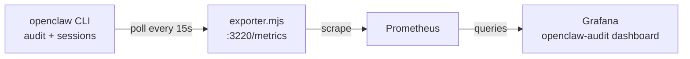

# OpenClaw Agent Telemetry

A thin Prometheus exporter and a Grafana dashboard for auditing OpenClaw agent
runs: which models ran, how often they failed, which tools broke, and when the
collector itself went silently stale.

An agent without telemetry is a cron job with a personality. This is the
minimum viable instrumentation: one ~200-line Node exporter wrapping the
`openclaw audit` / `openclaw sessions` CLI output, ten metric families, one
dashboard. No vendor APM, no sidecar mesh.

## Architecture

The exporter polls the OpenClaw CLI on a fixed interval (default 15s), joins
audit events to live session metadata, and serves a cached Prometheus
snapshot — scrapes never block on the CLI. Prometheus scrapes `/metrics`;
Grafana reads Prometheus. Failure data becomes label-bearing series (a recent
failures *table* out of an instant query, no Loki required).



## Exported metrics

| Metric | Type | Labels | Meaning |
|---|---|---|---|
| `openclaw_audit_event_total` | counter | `status`, `model`, `kind` | Audit events by terminal status (`succeeded`, `failed`, `started`, `cancelled`, `unknown`) |
| `openclaw_audit_event_by_model_total` | counter | `model`, `status` | Same counts broken down by model — per-model failure rates are the whole point |
| `openclaw_audit_failed_by_error_total` | counter | `error_code` | Failed events by error class; one code dominating is a config bug, not an off-day |
| `openclaw_audit_tool_failure_total` | counter | `tool` | Failed `tool_action` events per tool name |
| `openclaw_audit_event_by_kind_total` | counter | `kind`, `status` | Success/failure split per event kind (run vs tool action) |
| `openclaw_audit_recent_failure_timestamp_ms` | gauge | `error_code`, `tool`, `model`, `reason`, `rank`, `run_id` | The 20 most recent failures, timestamped — the dashboard renders this as a table |
| `openclaw_collector_last_refresh_timestamp_seconds` | gauge | — | Collector self-check: alert when it goes stale |
| `openclaw_collector_refresh_duration_seconds` | gauge | — | Poll duration; CLI slowdowns show up here first |
| `openclaw_collector_last_error_info` | gauge | `error` | Present only while the collector is failing |

The counters reflect the audit window (last `AUDIT_LIMIT` events), so they can
decrease when old events roll off. Treat `rate()` over short ranges with
suspicion; the dashboard uses instant values throughout.

Privacy note: `openclaw_audit_recent_failure_timestamp_ms` carries a
truncated (120-char) session last-message preview in its `reason` label. Keep
the scrape endpoint on loopback or a private network; set
`INCLUDE_REASON_LABELS=0` to drop it.

## Run the exporter

Requires Node ≥ 18 and an authenticated `openclaw` CLI on the same machine.

```sh
cd exporter
cp .env.example .env   # optional; defaults bind to 127.0.0.1:3220
node exporter.mjs
curl -s localhost:3220/metrics | head
```

## Scrape config

```yaml
scrape_configs:
  - job_name: openclaw-audit
    static_configs:
      - targets: ["127.0.0.1:3220"]   # host.docker.internal:3220 if Prometheus runs in Docker
        labels:
          service: openclaw-observability
```

## Import the dashboard

1. Grafana → Dashboards → **Import** → upload `dashboard/openclaw-audit.json`.
2. Select your Prometheus datasource when prompted, then **Import**.

Or via provisioning: copy `dashboard/openclaw-audit.json` into your dashboards
prov path (replace `${DS_PROMETHEUS}` with your datasource uid if you don't
use the prov datasource from `demo/`).

## Local demo stack (optional)

`demo/docker-compose.yml` runs Prometheus + Grafana wired to this repo:
exporter on the host at `:3220`, Prometheus scraping `host.docker.internal:3220`,
Grafana provisioned with the datasource and this dashboard.

```sh
node exporter/exporter.mjs &
cd demo && docker compose up -d
# Grafana: http://127.0.0.1:3215 (viewer login disabled; demo-only config)
```

## Layout

```
exporter/exporter.mjs        # the exporter, config via env only
exporter/.env.example        # all knobs, no secrets
dashboard/openclaw-audit.json# Grafana dashboard (__inputs, no hard-coded datasource)
demo/                        # optional prometheus+grafana compose for a local trial
docs/                        # screenshot
```

## Security posture

- The exporter binds `127.0.0.1` by default; there is no auth on `/metrics`,
  so do not expose it.
- No tokens, hosts, or internal URLs in code or config — everything is env.
- The dashboard JSON carries no datasource uid, IPs, or instance names.

MIT licensed. Built for [OpenClaw](https://github.com/openclaw/openclaw); the
audit/sessions JSON shape it parses is its own — expect to adapt field names
if yours differs.
